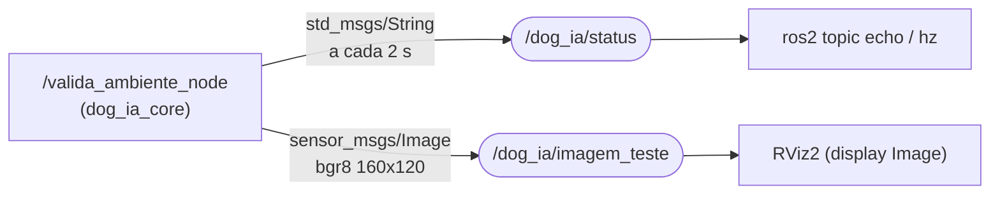
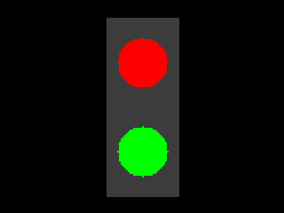

# Aula 07 — Revisão da Etapa 1 e Aplicação da Etapa 2

| | |
|---|---|
| **Projeto** | DOG-IA — Robô Cão-Guia Urbano de Inteligência Assistiva |
| **Disciplina** | Intelligent Mobile Robots (IMR) — Ciência da Computação, 6º semestre |
| **Data** | 26/10/2026 |
| **Roteiro da aula** | `AULA_07/aula07_IMR.txt`: (1) Revisão da parte 1 · (2) Aplicação da parte 2 |
| **Guia usado** | `AULA_07/Guia Projeto DOGUIA.md` — Etapa 1 (Configuração do Ambiente) e Etapa 2 (Workspace e Código Python) |

**O que foi entregue nesta aula**

| Arquivo | Para quê |
|---|---|
| `scripts/check_env.sh` | Parte 1: revisa a Etapa 1 inteira com um comando e grava o log de evidência |
| `dog_ia_core/` | Parte 2: pacote ROS 2 (`ament_python`) com o nó `valida_ambiente` |
| `scripts/valida_etapa2.sh` | Parte 2: compila, roda o nó, inspeciona o tópico `/dog_ia/status` e grava o log |
| `docs/evidencias/aula07/` | Logs gerados pelos scripts e prints do Gazebo, do RViz2 e dos terminais |

---

## Parte 1 — Revisão da Etapa 1 (Configuração do Ambiente)

### 1.1 Conceitos revisados

- **ROS 2** não é um sistema operacional. É um *middleware* que divide o robô em programas pequenos e independentes (**nós**). Os nós conversam por **tópicos** no padrão **publisher/subscriber**. No DOG-IA, isso garante que a visão computacional, que pode levar 0,5 s por imagem, não trave a leitura do LiDAR (requisito RNF01 do escopo).
- **Mensagem** é o formato do dado que passa no tópico, por exemplo `std_msgs/String` (texto), `sensor_msgs/Image` (câmera) e `sensor_msgs/LaserScan` (LiDAR).
- **Gazebo** é o "video game" do robô: simula a física (gravidade, atrito, colisões) e os sensores.
- **RViz2** é o "raio-X": não simula nada, só desenha o que o robô está enxergando e pensando (laser, mapa, rota, TFs). Quando o robô bate no Gazebo, é no RViz2 que a gente descobre se ele viu o obstáculo ou não.
- **WSL2 / WSLg** roda um kernel Linux real no Windows e deixa o Linux usar a GPU do Windows para abrir as janelas 3D.

### 1.2 O que foi instalado e onde cada coisa entra no projeto

| Pacote (apt) | Função no DOG-IA |
|---|---|
| `ros-humble-desktop-full` | ROS 2 Humble completo, com `rclpy`, RViz2 e as mensagens padrão |
| `ros-dev-tools` | `colcon` (compilação do workspace) e `rosdep` |
| `gazebo` + `ros-humble-gazebo-ros-pkgs` | Simulador Gazebo Classic 11 e plugins que ligam o Gazebo aos tópicos do ROS 2 |
| `ros-humble-xacro` + `ros-humble-joint-state-publisher-gui` | Modelagem URDF/Xacro do robô (próxima entrega) |
| `ros-humble-teleop-twist-keyboard` | Dirigir o robô pelo teclado publicando em `/cmd_vel` |
| `ros-humble-cv-bridge` + `python3-opencv` | Converter a imagem da câmera (`sensor_msgs/Image`) em matriz do OpenCV (`numpy.ndarray`) |

### 1.3 Como revisar a Etapa 1 com um comando

```bash
cd ~/ros2_ws/src/DOG-IA_ROBO_CAO-GUIA
bash scripts/check_env.sh
```

O script confere, em sequência:

1. **Sistema operacional:** Ubuntu 22.04, nativo ou WSL2. O ROS 2 Humble só tem pacotes oficiais para o 22.04.
2. **ROS 2:** `ROS_DISTRO=humble`, comando `ros2` disponível e `source /opt/ros/humble/setup.bash` no `~/.bashrc` (Passo 3).
3. **Pacotes:** `gazebo_ros`, `xacro`, `joint_state_publisher_gui`, `teleop_twist_keyboard`, `cv_bridge`, `demo_nodes_*` e `rviz2`. O Nav2 e o SLAM Toolbox aparecem só como aviso, porque entram a partir de 09/11.
4. **Parte gráfica:** Gazebo e RViz2 instalados, sessão gráfica ativa (WSLg), `/dev/dxg` presente no WSL2 e o renderizador OpenGL. Se aparecer `llvmpipe`, a renderização está sendo feita por software, sem GPU.
5. **Teste 1 do guia:** importa `rclpy`, `cv2` e `CvBridge` no Python.
6. **Smoke test (Passo 4):** roda o `talker` em C++ e o `listener` em Python ao mesmo tempo e conta as mensagens `I heard: [Hello World: X]`. Um nó em C++ conversando com um nó em Python mostra que o ROS 2 independe da linguagem: os dois só combinam o tópico (`/chatter`) e o tipo da mensagem.
7. **Workspace:** `~/ros2_ws/src` existe e o repositório está dentro dele.

O resultado vai para a tela e para `docs/evidencias/aula07/check_env_<data>.log`.

Os testes gráficos continuam manuais, em dois terminais:

```bash
gazebo     # Terminal 1: a janela 3D do Gazebo deve abrir sem crash
rviz2      # Terminal 2: a interface do RViz2 deve abrir com os painéis
```

### 1.4 Problemas comuns na Etapa 1 e como resolver

| Sintoma | Causa provável | Solução |
|---|---|---|
| `ros2: command not found` | ROS 2 não foi carregado no terminal | `source /opt/ros/humble/setup.bash` (e conferir o `~/.bashrc`) |
| `E: Unable to locate package ros-humble-...` | Ubuntu diferente do 22.04 (o 24.04 usa o ROS 2 Jazzy) | `lsb_release -a`; no Windows, `wsl --install -d Ubuntu-22.04` |
| `listener` mostra mensagens de **outro grupo** ou o `topic list` mostra tópicos estranhos | No laboratório, todas as máquinas estão na mesma rede e no mesmo `ROS_DOMAIN_ID` (0) | Cada grupo usa um ID próprio: `echo "export ROS_DOMAIN_ID=<nº do grupo>" >> ~/.bashrc` |
| `listener` não recebe nada | Terminais com `ROS_DOMAIN_ID` ou `ROS_LOCALHOST_ONLY` diferentes, ou firewall | Conferir com `printenv \| grep ROS` nos dois terminais |
| Gazebo demora muito ou fica com a tela preta na primeira execução | O Gazebo Classic tenta baixar a base de modelos da internet | Esperar o primeiro carregamento, ou rodar com `GAZEBO_MODEL_DATABASE_URI="" gazebo` |
| Gazebo ou RViz2 abrem muito lentos no WSL2 | Renderização por software (`llvmpipe`) | `wsl --update` no PowerShell, atualizar o driver de vídeo do Windows e reiniciar com `wsl --shutdown` |
| RViz2 fecha sozinho no WSL2 | Driver OpenGL incompatível | Último recurso: `export LIBGL_ALWAYS_SOFTWARE=1` antes do `rviz2` |

### 1.5 Ponto de atenção do guia

O e-mail do professor aparece diferente nos dois guias: `flaviosantarelli@gmail.com` no guia da Etapa 1 (05/10) e `flavio.santarelli@pro.fecaf.com.br` no guia da Aula 07. O checklist desta aula usa o institucional. Para garantir, vale convidar os dois como colaboradores no GitHub.

---

## Parte 2 — Aplicação da Etapa 2 (Workspace e Código Python)

### 2.1 Conceitos aplicados

| Conceito | Onde aparece no código |
|---|---|
| **`rclpy`** (biblioteca cliente do ROS 2 em Python) | `rclpy.init()`, `rclpy.spin()`, `rclpy.shutdown()` |
| **Nó** (classe que herda de `Node`) | `ValidaAmbienteNode`, registrado como `valida_ambiente_node` |
| **Publisher** | `create_publisher(String, 'dog_ia/status', 10)`. O `10` é o tamanho da fila (QoS *depth*) |
| **Timer + callback** | `create_timer(2.0, self.publica_status)` chama a função a cada 2 s, sem `while True` nem `sleep` |
| **`spin`** | Mantém o nó vivo, despachando os callbacks até o Ctrl+C |
| **`cv_bridge`** | Converte `numpy.ndarray` (OpenCV) ↔ `sensor_msgs/Image` (ROS 2) |

### 2.2 Anatomia do pacote `ament_python`

O pacote foi criado com o comando do guia:

```bash
cd ~/ros2_ws/src/DOG-IA_ROBO_CAO-GUIA
ros2 pkg create --build-type ament_python dog_ia_core --dependencies rclpy sensor_msgs cv_bridge std_msgs
```

```
~/ros2_ws/                         ← workspace (colcon build roda aqui)
└── src/
    └── DOG-IA_ROBO_CAO-GUIA/      ← este repositório
        ├── docs/
        ├── scripts/
        └── dog_ia_core/           ← pacote ROS 2
            ├── package.xml        ← nome, versão e dependências (rclpy, cv_bridge, std_msgs, sensor_msgs, OpenCV)
            ├── setup.py           ← entry_points: 'valida_ambiente = dog_ia_core.valida_ambiente:main'
            ├── setup.cfg          ← instala o executável em lib/dog_ia_core (onde o 'ros2 run' procura)
            ├── resource/dog_ia_core   ← marcador vazio que registra o pacote no índice do ament
            ├── dog_ia_core/
            │   ├── __init__.py
            │   └── valida_ambiente.py ← o nó
            └── test/              ← testes de estilo padrão do ROS 2 (flake8, pep257, copyright)
```

O `colcon` procura `package.xml` recursivamente dentro de `src/`. Por isso o pacote pode ficar dentro da pasta do repositório, sem precisar estar direto em `src/`.

### 2.3 O nó `valida_ambiente`

O código segue o do guia (mesmo nome de nó, tópico, período de 2,0 s e texto da mensagem), comentado linha a linha. Ele também tem quatro ajustes que deixam a validação mais completa:

1. **Autoteste do `cv_bridge` na inicialização.** No código do guia, `cv2` e `CvBridge` eram importados mas não usados. Ou seja, o nó publicava "ROS 2 + OpenCV Prontos!" sem testar o OpenCV. Agora o nó desenha uma imagem sintética (um semáforo) com OpenCV, converte para `sensor_msgs/Image` e de volta, e compara pixel a pixel. Se falhar, publica uma mensagem de falha no lugar da de sucesso. Isso também evita o erro F401 (*import* não usado) no `colcon test`.
2. **Tópico extra `/dog_ia/imagem_teste`** (`sensor_msgs/Image`, `frame_id = camera_link`). Ele permite ver a imagem no RViz2, primeiro uso real do RViz2 no projeto, e já é o formato que a câmera RGB-D vai publicar na etapa de visão (16/11).
3. **Parâmetro `periodo_s`** (padrão 2.0). Muda a frequência sem recompilar: `ros2 run dog_ia_core valida_ambiente --ros-args -p periodo_s:=1.0`. O valor precisa ter casa decimal (`1.0`), porque o parâmetro é do tipo *double*.
4. **Encerramento limpo.** `rclpy.shutdown()` só é chamado se `rclpy.ok()`. No Humble, o Ctrl+C às vezes já encerra o contexto, e o segundo `shutdown` gera erro.

As strings usam aspas simples, que é o padrão exigido pelo `ament_flake8`.

### 2.4 Passo a passo de execução

**Terminal 1: compilar e rodar**

```bash
# 0. Repositório dentro do workspace (só na primeira vez)
cd ~/ros2_ws/src
git clone https://github.com/<usuario>/DOG-IA_ROBO_CAO-GUIA.git

# 1. Compilar a partir da raiz do workspace
cd ~/ros2_ws
colcon build --symlink-install

# 2. Carregar o overlay do workspace
source install/setup.bash

# 3. Executar o nó
ros2 run dog_ia_core valida_ambiente
```

> Com `--symlink-install`, o executável aponta para o `.py` do `src/`. Editar o código não exige recompilar. Só `setup.py` e `package.xml` exigem um novo `colcon build`.

**Terminal 2: inspecionar o que o nó publica**

```bash
source ~/ros2_ws/install/setup.bash
ros2 node list                        # /valida_ambiente_node
ros2 topic list                       # /dog_ia/status e /dog_ia/imagem_teste
ros2 topic info /dog_ia/status        # Type: std_msgs/msg/String | Publisher count: 1
ros2 topic echo /dog_ia/status        # data: 'DOG-IA Operacional: ROS 2 + OpenCV Prontos!'
ros2 topic hz /dog_ia/status          # average rate: ~0.500 (1 mensagem a cada 2 s)
rqt_graph                             # grafo: nó -> tópicos
```

**Terminal 3: ver a imagem no RViz2**

```bash
rviz2
# Add → By topic → /dog_ia/imagem_teste → Image
```

**Tudo isso automatizado e salvo como evidência:**

```bash
bash scripts/valida_etapa2.sh            # build + execução + inspeção do tópico
bash scripts/valida_etapa2.sh --testes   # também roda o colcon test (linters do ROS 2)
```

### 2.5 Saída esperada

Terminal 1 (`ros2 run dog_ia_core valida_ambiente`):

```
[INFO] [...] [valida_ambiente_node]: OpenCV 4.5.4 | cv_bridge: imagem 160x120 (bgr8) convertida ida e volta -> pixels identicos
[INFO] [...] [valida_ambiente_node]: ✅ Nó de Validação do DOG-IA iniciado com sucesso!
[INFO] [...] [valida_ambiente_node]: Mensagem Publicada #1: "DOG-IA Operacional: ROS 2 + OpenCV Prontos!"
[INFO] [...] [valida_ambiente_node]: Mensagem Publicada #2: "DOG-IA Operacional: ROS 2 + OpenCV Prontos!"
```

Terminal 2 (`ros2 topic echo /dog_ia/status`):

```
data: 'DOG-IA Operacional: ROS 2 + OpenCV Prontos!'
---
```

A versão do OpenCV que aparece depende da máquina (4.5.4 é a do `python3-opencv` do Ubuntu 22.04).

### 2.6 Grafo de comunicação desta etapa



### 2.7 Ligação com as próximas etapas

- O `/dog_ia/status` é o primeiro tópico com o prefixo do projeto. Os próximos nós seguem o mesmo padrão (`/dog_ia/obstacles`, `/dog_ia/traffic_state`, `/dog_ia/alerts`, previstos no escopo).
- A imagem de teste é um semáforo com as luzes vermelha e verde. O `traffic_vision_node` da etapa de visão vai fazer o caminho inverso: receber `sensor_msgs/Image`, converter com `cv_bridge` e segmentar as cores em HSV.
- O `frame_id = camera_link` já usa o nome do link da câmera que vai entrar no Xacro do robô.

---

## Checklist de avaliação e nivelamento (Aula 07)

| Requisito | Como comprovar | Status |
|---|---|:---:|
| ROS 2 Humble e Gazebo instalados e operacionais | `scripts/check_env.sh` sem falhas + prints do `gazebo` e do `rviz2` abertos | [ ] |
| Repositório no GitHub criado com o arquivo `docs/escopo_dog-ia_robo.md` | Link do repositório | [x] |
| Professor adicionado no GitHub (`flavio.santarelli@pro.fecaf.com.br`) | Settings → Collaborators | [ ] |
| Workspace `~/ros2_ws` compilado com o pacote `dog_ia_core` | Seção 1 do log `etapa2_<data>.log` (`colcon build` concluído) | [ ] |
| Nó `valida_ambiente` transmitindo mensagens no tópico `dog_ia/status` | Seção 3 do log `etapa2_<data>.log` + print do `ros2 topic echo` | [ ] |

## Evidências (`docs/evidencias/aula07/`)

| Arquivo | Origem |
|---|---|
| `check_env_<data>.log` | `bash scripts/check_env.sh` |
| `etapa2_<data>.log` | `bash scripts/valida_etapa2.sh` |
| `01_gazebo.png` | Print da janela do Gazebo aberta |
| `02_rviz2_imagem_teste.png` | Print do RViz2 com o display Image em `/dog_ia/imagem_teste` |
| `03_terminais_no_e_echo.png` | Print do `ros2 run` e do `ros2 topic echo` lado a lado |
| `04_rqt_graph.png` | Print do `rqt_graph` |
| `imagem_teste_esperada.png` | Referência de como a imagem de teste deve aparecer no RViz2 |


