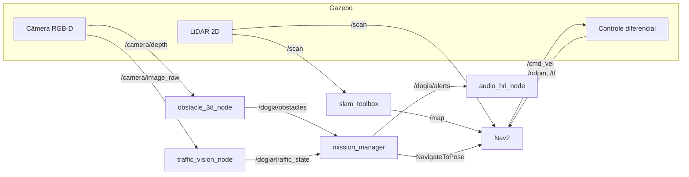

# Escopo do Projeto — DOG-IA: Robô Cão-Guia Urbano de Inteligência Assistiva

| | |
|---|---|
| **Disciplina** | Intelligent Mobile Robots (IMR) — Ciência da Computação, 2º sem/2026 |
| **Professor** | Flavio Santarelli |
| **Avaliações** | AC-3 (Fase 1) e AC-4 (Fase 2) |
| **Versão do documento** | 1.0 — 05/10/2026 |
| **Base** | Guia Oficial — Projeto AC 3 e 4, Guia Fase 1 / Etapa 01 (05/10/2026) e Aula 06 (fundamentação ROS 2) |

## 1. Equipe

| Nome completo | R.A. |
|---|---|
| Leandro Laurindo Soares | 82263 |
| Camila Cesco Ferreira | 134666 |
| Marcelo Luna Ierardi | 95121 |

**Frentes de trabalho** (cada frente tem um responsável principal e um revisor, para que todos conheçam todo o sistema):

| Frente | Escopo | Fases |
|---|---|---|
| Infraestrutura e simulação | Ambiente, workspace, URDF/Xacro, mundo no Gazebo, TF2 | AC-3 |
| Navegação e percepção 3D | SLAM Toolbox, Nav2, costmaps, detecção de obstáculos suspensos e buracos | AC-3 |
| Visão e interação | OpenCV (semáforo/faixa), nó de áudio (TTS), integração da missão, relatório e vídeo | AC-4 |

Responsáveis por frente: a definir na reunião de kickoff e registrar no quadro Kanban do repositório.

## 2. Contexto e problema

Pessoas com deficiência visual enfrentam barreiras diárias de mobilidade urbana. O cão-guia é a solução tradicional mais eficiente, mas é caro, leva até dois anos para ser treinado e tem fila de espera de anos no Brasil. Além disso, calçadas esburacadas, orelhões, galhos de árvores (invisíveis para bengalas) e travessias sem sinal sonoro tornam trajetos simples em tarefas de alto risco.

## 3. Objetivos

**Objetivo geral.** Desenvolver o protótipo de um robô guia autônomo, em ambiente simulado, que atua à frente do usuário para guiá-lo com segurança por um trajeto urbano.

**Objetivos específicos.**

1. Navegar e mapear a calçada de forma autônoma e segura (SLAM + Nav2).
2. Detectar obstáculos em 3D, em especial os aéreos/suspensos e buracos.
3. Reconhecer a sinalização urbana (faixa de pedestres e estado do semáforo) por visão computacional.
4. Emitir alertas de voz em tempo real orientando o usuário sobre o percurso.

## 4. Escopo

### 4.1 Dentro do escopo

- Robô diferencial simulado (rodas motrizes + roda boba) descrito em URDF/Xacro.
- Sensores simulados: LiDAR 2D no chassi e câmera RGB-D inclinada para obstáculos suspensos.
- Mundo urbano simulado no Gazebo: calçada, faixa de pedestres, semáforo, obstáculos aéreos e buracos.
- Mapeamento com SLAM Toolbox e navegação autônoma com Nav2 (costmap local/global, raio de inflação).
- Nó em Python com ROS 2 + OpenCV (`cv_bridge`) para cor do semáforo e/ou faixa de pedestres.
- Lógica de missão que impede a travessia com sinal vermelho.
- Nó de áudio com Text-to-Speech em Python.
- Pacotes ROS 2 em Python, arquivos `.launch.py` e configurações do Nav2 versionados em Git.

### 4.2 Fora do escopo (decisão do grupo)

- Hardware físico, atuadores reais e testes em ambiente real.
- GPS, mapas urbanos reais e navegação de longa distância.
- Detecção e previsão de movimento de pedestres e veículos em movimento.
- Treinamento de redes neurais próprias (a visão usará processamento clássico com OpenCV).
- Interface de usuário além do áudio (aplicativo, háptico, etc.).

## 5. Requisitos

### 5.1 Funcionais

| ID | Requisito | Fase |
|---|---|---|
| RF01 | O robô deve ser descrito em Xacro/URDF e carregar no Gazebo sem erros | AC-3 |
| RF02 | O robô deve responder a comandos em `/cmd_vel` e publicar `/odom` e TFs sem erros no RViz2 | AC-3 |
| RF03 | O sistema deve gerar um mapa 2D do ambiente urbano simulado com o SLAM Toolbox | AC-3 |
| RF04 | O robô deve navegar de forma autônoma até um ponto definido no RViz2, mantendo distância de segurança dos obstáculos (raio de inflação configurado) | AC-3 |
| RF05 | O sistema deve detectar obstáculos suspensos e buracos usando a câmera RGB-D | AC-3/AC-4 |
| RF06 | O sistema deve identificar a cor do semáforo (verde/vermelho) ou a faixa de pedestres na imagem da câmera | AC-4 |
| RF07 | O robô deve interromper a trajetória ao detectar sinal vermelho e retomar quando o sinal abrir | AC-4 |
| RF08 | O sistema deve emitir alertas de voz (ex.: "Sinal vermelho, aguarde na calçada", "Em frente em 5 metros", "Obstáculo suspenso detectado") | AC-4 |

### 5.2 Não funcionais

| ID | Requisito |
|---|---|
| RNF01 | Arquitetura em nós independentes (microsserviços ROS 2): a lentidão da visão não pode bloquear a leitura do LiDAR |
| RNF02 | Código em Python, com pacotes ROS 2 construídos com `colcon` |
| RNF03 | Ambiente reproduzível: Ubuntu 22.04 LTS (nativo ou WSL2), ROS 2 Humble e Gazebo Classic (`gazebo`) iguais em todas as máquinas do grupo |
| RNF04 | Missão cumprida de forma 100% autônoma, sem teleoperação, no vídeo de demonstração |
| RNF05 | Tudo versionado no Git, com histórico de contribuições de todos os integrantes |

### 5.3 Metas de qualidade propostas

| Métrica | Meta |
|---|---|
| Colisões durante a missão de referência | 0 em 3 execuções consecutivas |
| Parada com sinal vermelho | Robô para antes da faixa de pedestres |
| Latência do alerta de voz após o evento | menor que 1 s |
| Frequência de leitura do LiDAR | mantida (~10 Hz) mesmo com o nó de visão ativo |

Essas metas são propostas do grupo e podem ser ajustadas conforme os experimentos.

## 6. Missão de referência (cenário de demonstração)

1. O robô parte do ponto A, à frente do usuário, em uma calçada.
2. Desvia de um buraco e de um obstáculo suspenso (ex.: galho ou orelhão) e avisa por voz.
3. Chega à faixa de pedestres. Com o semáforo vermelho, para e avisa: "Sinal vermelho, aguarde na calçada".
4. Quando o semáforo fica verde, atravessa.
5. Chega ao ponto B e informa a chegada.

Essa missão alimenta o vídeo (até 3 min) e a apresentação final.

## 7. Arquitetura preliminar



**Nós previstos** (nomes preliminares, a refinar na modelagem):

| Nó | Função | Publica | Assina |
|---|---|---|---|
| `slam_toolbox` | Mapeamento 2D | `/map`, `/tf` | `/scan`, `/odom` |
| Nav2 (stack) | Planejamento global/local, costmaps | `/cmd_vel` | `/map`, `/scan`, `/odom` |
| `obstacle_3d_node` | Obstáculos suspensos e buracos pela RGB-D | `/dogia/obstacles` | `/camera/depth/...` |
| `traffic_vision_node` | Cor do semáforo e faixa (OpenCV + `cv_bridge`) | `/dogia/traffic_state` | `/camera/image_raw` |
| `mission_manager` | Máquina de estados da missão | metas do Nav2, `/dogia/alerts` | `/dogia/obstacles`, `/dogia/traffic_state` |
| `audio_hri_node` | Text-to-Speech | — | `/dogia/alerts` |

**Árvore TF2 prevista:** `map → odom → base_footprint → base_link → {lidar_link, camera_link, rodas}`.

**Estados da missão (`mission_manager`):** `NAVEGANDO → AGUARDANDO_SINAL → ATRAVESSANDO → CHEGOU`, com sobreposição de alerta para obstáculos. É a evolução da máquina de estados do Lab 5 da Aula 05, trocando a lógica reativa por metas do Nav2.

## 8. Tecnologias

| Camada | Tecnologia |
|---|---|
| Sistema | Ubuntu 22.04 (nativo ou WSL2 com WSLg) |
| Middleware | ROS 2 Humble (`ros-humble-desktop-full`) |
| Simulação / visualização | Gazebo Classic (`gazebo`, via `ros-humble-gazebo-ros-pkgs`) e RViz2 |
| Mapeamento e navegação | SLAM Toolbox e Nav2 (`ros-humble-slam-toolbox`, `ros-humble-navigation2`, `ros-humble-nav2-bringup`) |
| Modelagem | URDF/Xacro (`ros-humble-xacro`, `ros-humble-joint-state-publisher-gui`) |
| Visão | Python, OpenCV (`python3-opencv`), `cv_bridge` |
| Teleoperação | `ros-humble-teleop-twist-keyboard` |
| Áudio | Biblioteca de Text-to-Speech em Python (a escolher: offline ou online) |
| Reprodutibilidade | Docker (containers), como plano B de ambiente |
| Versionamento e gestão | Git, GitHub e quadro Kanban (GitHub Projects) |

## 9. Cronograma, entregas e critérios de aceite

| Data | Pontos | Entrega | Critério de aceite (check de validação) |
|---|---|---|---|
| 05/10 | 0,25 | Setup de ambiente: WSL2/Linux, ROS 2, Gazebo, RViz2, `ros2_ws` | Gazebo rodando o comando de teste gráfico no terminal (aplicado a cada integrante, por segurança); script Python de validação sem erros de importação; telas do Gazebo e RViz2 |
| 26/10 | 0,25 | Modelagem Xacro/URDF do robô e sensores (LiDAR 2D + RGB-D), plugins do Gazebo | Robô carrega no Gazebo, responde a `/cmd_vel` e publica TFs sem erros no RViz2 |
| 09/11 | 0,50 | SLAM 2D e Nav2 (costmaps, raio de inflação) | Primeira versão da documentação + robô navegando de forma autônoma até um ponto via RViz2 |
| 16/11 | 0,25 | Nó de visão (ROS 2 + OpenCV) e lógica de parada | Robô interrompe a trajetória ao detectar sinal vermelho na imagem simulada |
| 23/11 | 0,25 | Nó de áudio, testes de estresse, vídeo (2 a 3 min) e relatório | Vídeo e relatório entregues no repositório |
| 30/11 | 0,50 | Apresentação final (até 10 min) e fechamento | Simulação ao vivo no Gazebo/RViz2 e entrega dos 4 artefatos completos |

Dias sem aula no semestre: 12/10 (feriado), 19/10 (TechWeek) e 02/11 (feriado). O intervalo entre 05/10 e 26/10 tem duas semanas sem aula e deve ser usado para adiantar a modelagem do robô.

## 10. Entregáveis finais

1. **Arquitetura do sistema:** diagramas de nós, tópicos, serviços, ações e árvore TF2.
2. **Código-fonte:** pacotes ROS 2 em Python, modelos URDF/Xacro, `.launch.py` e configurações do Nav2, no repositório Git.
3. **Documentação e relatório técnico:** solução, metodologia, experimentos e análise de resultados.
4. **Vídeo de demonstração (até 3 min):** gravação de tela da missão 100% autônoma no simulador.
5. **Apresentação em sala:** até 10 minutos por grupo.

## 10.1 Estrutura do repositório

O repositório é clonado dentro do workspace (`~/ros2_ws/src/DOG-IA_ROBO_CAO-GUIA`), conforme o guia do projeto (Aula 07), e cada pacote ROS 2 fica na raiz do repositório.

```
~/ros2_ws/src/DOG-IA_ROBO_CAO-GUIA/
├── README.md
├── docs/                 # escopo, relatório, diagramas, evidências
├── scripts/              # utilitários (check_env.sh, valida_etapa2.sh)
├── dog_ia_core/          # pacote núcleo (Aula 07): nó valida_ambiente, tópico /dog_ia/status
└── ...                   # próximos pacotes (dogia_description, dogia_bringup, dogia_navigation, dogia_vision, dogia_audio, dogia_mission)
```

## 11. Riscos e mitigação

| Risco | Impacto | Mitigação |
|---|---|---|
| Ambientes diferentes entre os integrantes (versões, GPU, WSLg) | Alto | Mesma versão de ROS 2/Gazebo, `scripts/check_env.sh` rodado por todos, Docker como plano B |
| Simulação 3D pesada ou lenta no WSL2 | Alto | Confirmar uso da GPU via WSLg, mundo simples no início, reduzir taxa e resolução dos sensores |
| Duas semanas sem aula entre 05/10 e 26/10 | Médio | Adiantar o Xacro do robô e o mundo no Gazebo nesse intervalo |
| Visão falhar com iluminação do simulador | Médio | Processamento por cor em HSV, calibração em imagens simuladas, limiar ajustável por parâmetro ROS |
| Integração tardia dos nós | Alto | Integrar a cada marco, contratos de mensagem definidos cedo, branch `main` sempre executável |
| Concentração do trabalho em um só integrante | Médio | Revisão cruzada por Pull Request e commits de todos os integrantes |
| Áudio indisponível ou sem som no WSL2 | Baixo | Testar o TTS cedo; manter o texto do alerta também em log e no RViz2 |

## 12. Gestão e colaboração

- **Repositório:** `DOG-IA_ROBO_CAO-GUIA`, com todos os integrantes e o professor como colaboradores.
- **Branches:** `main` estável; ramos `feature/<frente>-<descricao>` por tarefa.
- **Integração:** Pull Request com revisão de pelo menos um colega antes do merge.
- **Commits:** mensagens curtas no imperativo (ex.: `add xacro do chassi`).
- **Kanban (GitHub Projects):** colunas `Backlog`, `Em andamento`, `Em revisão`, `Concluído`; um cartão por requisito ou tarefa.
- **Definição de pronto:** código no `main`, executando a partir do `ros2_ws`, com evidência (print ou saída de terminal) em `docs/`.

## 13. Referências

- Guia Oficial — Projeto AC 3 e 4.
- Conteúdo teórico da Aula 06 (ROS 2, WSL2/WSLg, Docker, Gazebo e RViz2).
- Guia Fase 1 / Etapa 01 (`guia_fase1_etapa1_aula05102026.pdf`): instalação, workspace `~/ros2_ws` e testes de validação.
